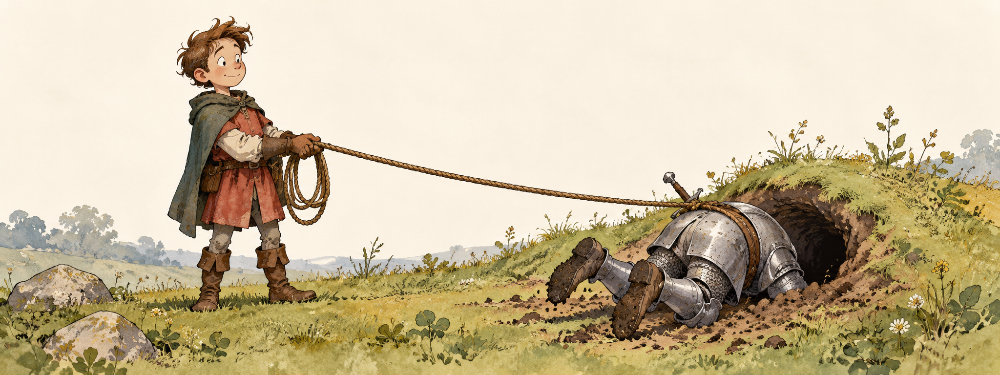

# Squire

**Your agent has been fixing the same bug for forty minutes. It has a new theory. This is its seventh new theory.**

Someone should probably say something.

Squire is a sidekick for a coding agent. It watches the session from outside, checks what’s happening against the plan, and speaks up when the agent looks stuck, confused, or impressively busy solving the wrong problem.

## Someone has to hold the rope

When an agent struggles, the usual response is to give it more: more instructions, more tools, more memory. Useful stuff. But you can build a magnificent cockpit around a pilot who is flying into a mountain.

Sometimes the missing ingredient is another perspective.

You’ve probably supplied that perspective yourself. You glance at a run and ask: “Wait, did we ever check that assumption?” The agent pauses. The elaborate theory collapses. Work resumes on the actual problem.

Squire gives that job to another agent. One that hasn’t spent the last forty minutes becoming emotionally invested in a cache invalidation theory.

An illustrative nudge:

> **[squire]** The last three fixes assume the response is cached, but none of the checks established that. Inspect the response headers before changing another cache setting.

That’s the whole idea. A short interruption at the right moment can be worth more than another page of instructions.

## What it does

A squire follows one working agent and its plan. It checks new transcript activity every few minutes and keeps its own continuing conversation, so it can follow the run over time.

It looks for consequential wrong turns: repeated attempts without new evidence, a hypothesis quietly promoted to fact, a misunderstood request, or a skipped step that matters. When it has something concrete to say, it sends a brief `[squire]` message into the working session. Otherwise, it stays quiet. Nobody needs a colleague who says “looks good” every six minutes.

The working agent stays in charge. It can ask the squire to explain, correct its reading, or tune its advice. The squire can inspect files, but it doesn’t edit them or take over the task. Its messages are advice, not instructions from you.

## Give your agent a squire

Copy this into your coding agent:

```text
Set up Squire for me: https://github.com/Perttulands/squire

Read the README, skills/squire/SKILL.md, and the implementation. Inspect
my existing agent setup, available CLIs, authenticated providers, and
terminal/session environment. Recommend which harness and model should
run the squire, and how it should observe and communicate with my working
agent. Explain your choice briefly.

Install Squire in a suitable local directory and make its skill available
to my agent. Adapt paths and configuration to this machine. If my setup
needs a different observer backend or delivery mechanism, explain the
necessary code changes before making them; don't assume changing a model
flag changes the backend.

Verify the setup, then show me how to start a squire with a plan, talk to
it, check its status, and stop it. Ask me for any missing credentials or
consequential setup choices. Keep credentials and transcripts private.
```

The supplied implementation uses Python 3.10+, tmux, and an authenticated Codex CLI for the observer. It can watch Claude Code or Codex sessions in tmux. The observer model is configurable; another provider or session interface needs a local adaptation. Your agent can work out what fits your setup.

### Hands-on setup

Clone the repository into a directory you want to keep:

```bash
git clone https://github.com/Perttulands/squire.git
cd squire
./squire --help
```

There are no Python packages to install. Have your agent read the [Squire skill](skills/squire/SKILL.md) for installation and session discovery. Keep the executable with its accompanying `instructions/` directory.

From the working agent’s own tmux pane, using the path to your checkout:

```bash
/path/to/squire/squire start --plan 'Fix the failing request. Establish the cause, make the fix, and verify the original failure is gone.'
/path/to/squire/squire status
/path/to/squire/squire tell NAME 'What evidence would distinguish those two explanations?'
/path/to/squire/squire stop NAME
```

`NAME` is the pair name shown by `start` or `status`. `--model` chooses the observer model; `--mode assist` also invites useful leads, sources, and next steps. The default `guard` mode focuses on wrong turns.

## Under the hood

The pair is the system: one worker, one observer, a plan, and a conversation. No committee required.

Checks happen only when the transcript grows. The default interval is six minutes. Advice is at most 400 characters, and delivery waits for a recognized harness prompt without a draft or dialog. If the terminal doesn’t look safe to type into, Squire waits rather than guessing. Status shows deferred delivery and failures.

The observer reads session content and can investigate local files using a read-only shell. That context goes to the observer’s model provider, so choose it with the same care as your working agent.

- [Design](docs/DESIGN.md) — architecture and decisions.
- [Skill](skills/squire/SKILL.md) — setup, attachment, and conversation.
- [Observer instructions](instructions/squire.md) — what the squire pays attention to.
- `./squire --help` — commands, including offline replay.

Run the tests:

```bash
python3 -m unittest discover -s tests -v
```

[MIT licensed](LICENSE). Give your agent someone to talk to.
